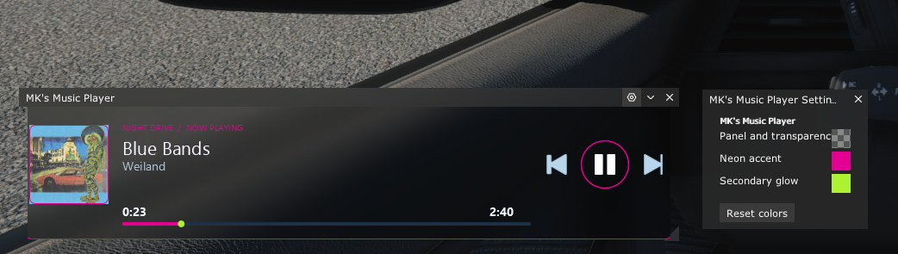

# MK's Music Player

  

A small, resizable music player for Assetto Corsa that lets you control your music and see what's currently playing, using Custom Shaders Patch (CSP).

## Features

- Displays the track name, artist, album artwork, and playback progress when available.
- Previous, play/pause, and next buttons using CSP's media controls.
- Customizable panel and accent colors.
- Saves your color settings between sessions.
- Resizable window with a minimum size to keep everything readable.

## Installation

1. Place the `MKsMusicPlayer` folder in `assettocorsa/apps/lua`.
2. Launch Assetto Corsa.
3. Enable and open **MK's Music Player** from the Lua apps menu.

## Compatibility

This is a CSP Lua app for Assetto Corsa, not a standalone desktop music player so you need CSP installed

Available track information, album artwork, and media controls depend on the music source, CSP, and your operating system. If track information or cover art isn't available, the player will display a placeholder instead.

The player doesn't control the game's volume or your master volume.

## Tested Environment

MK's Music Player was created and tested using the following setup:

- **Custom Shaders Patch (CSP):** 0.2.6
- **Sol:** 2.2.9
- **Operating System:** Windows 11

Compatibility with other CSP versions, weather mods, and operating systems has not been verified.

## Known Limitations

- It's best to start Spotify, YouTube, or another supported music source and begin playback before launching Assetto Corsa. CSP might not pick up track information or album artwork if playback starts after the game.
- Album artwork might not appear when you first open the app. If this happens, close MK's Music Player, wait 5 seconds, and reopen it to load the current album cover.

## Controls

- **Previous / Play-Pause / Next:** Control music playback.
- **Settings:** Change the panel and accent colors.
- **Resize:** Drag the window borders to adjust its size.

## Credits

Created by MK as a personal hobby project, with some help from AI for coding and implementation ideas.

The now-playing display and media controls were inspired in part by CSP's Android Auto and media player functionality.

MK's Music Player is an independent project and isn't an official CSP app.

## License

MK's Music Player is distributed under the terms of the [MK's Music Player License](LICENSE.md).

You are free to use, modify, and redistribute the project under the license terms. Modified versions must credit MK as the original creator and clearly identify their own changes.

See [LICENSE.md](LICENSE.md) for the full terms.
